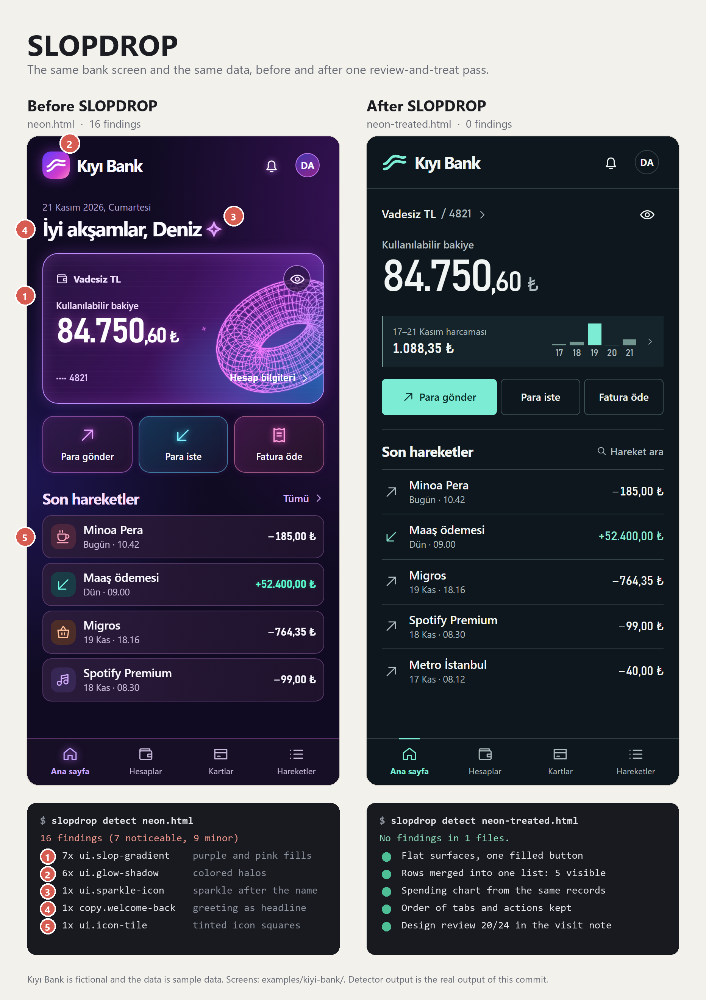

# SLOPDROP

**Stop AI slop in your UI/UX.** Mobile, web, spatial. Copy included.



Slop is not ugly. Slop is generic: the purple gradient, the white card with a gray border, the sparkle where search used to be, "Oops! Something went wrong", "Trusted by 10,000+ teams", a web page floating in a headset, a hero section inside a phone app.

SLOPDROP is three things that share one brain:

1. **A review skill for your coding agent.** `/slopdrop review`, `treat`, `scan`, `chart`, `follow-up`. It finds what users actually complain about before it comments on your palette, scores the screen out of 24, and fixes at the token and component level instead of repainting screens.
2. **A deterministic detector.** 68 rules, 48 of them executed over SwiftUI, UIKit, Compose, Android XML, React Native, Expo, Flutter, Ionic, React, Next.js, Vue, Svelte, Astro, HTML/CSS, Tailwind, and the spatial stacks. No model, no network, no dependencies. Color-aware: it reads the hue of a gradient or a glow instead of guessing from its spelling. English and Turkish interface copy. Exit code `2` gates a pull request; `--format sarif` puts the hits in GitHub code scanning.
3. **A local-first project brain.** One SQLite database, exposed over MCP, shared by Claude Desktop, Google Antigravity, and OpenAI Codex (and anything else that speaks MCP). The chart, the findings, the visits, the waivers, and the design tokens stay in sync while three agents work on the same project.

Read the thinking in [DESIGN.md](DESIGN.md) (Turkish) and the system map in [ARCHITECTURE.md](ARCHITECTURE.md).

---

## Quickstart

```bash
# in the project you want reviewed
npx slopdrop init            # writes .slopdrop/ and registers the MCP server
npx slopdrop scan src/       # deterministic pass, no model, exit 2 on findings
```

Then, in any agent that has the skill installed:

```text
/slopdrop review the checkout screen      # diagnosis + score, no edits
/slopdrop treat the checkout screen       # diagnose, agree a direction, fix, verify
/slopdrop chart                           # record top tasks, brand, accepted exceptions
/slopdrop follow-up checkout              # re-review and compare with the last visit
```

Install the skill where your agent looks for it:

| Agent | Installs to | Invoke |
|---|---|---|
| Claude Code / Claude Desktop | `~/.claude/skills/slopdrop` | `/slopdrop` |
| OpenAI Codex | `~/.agents/skills/slopdrop` | `$slopdrop` |
| Google Antigravity | `~/.gemini/skills/slopdrop` | `/slopdrop` |
| Cursor | `~/.agents/skills/slopdrop` | `/slopdrop` |
| OpenCode | `~/.agents/skills/slopdrop` | `/slopdrop` |
| Gemini CLI | `<project>/.gemini/skills/slopdrop` | `/slopdrop` |
| GitHub Copilot | `<project>/.github/skills/slopdrop` | `/slopdrop` |

```bash
npx slopdrop install --agent claude,codex,antigravity
npx slopdrop install --project        # commit the folder, the whole team gets it
npx slopdrop install --dir path/to/skills
```

## Three agents, one project

```bash
npx slopdrop mcp install     # detects Claude Desktop, Antigravity, Codex and writes their MCP config
npx slopdrop sync status     # who wrote what, what changed since your last read
npx slopdrop sync export     # writes chart.md, findings.jsonl, waivers.json, visits/ for git
npx slopdrop sync import     # rebuilds the database from those files
```

One SQLite file per project lives at `.slopdrop/project.db`. Every agent connects over MCP; every write is an event with an actor, a base revision, and an idempotency key. Conflicts are recorded, never silently overwritten. Your project stays readable as text: the database is the index and the bus, the committed markdown is the truth.

## What the detector reads

Mobile: SwiftUI, UIKit, Jetpack Compose, Android XML, React Native, Expo, Flutter, Ionic, Capacitor, NativeScript.
Web: React, Next.js, Vue, Nuxt, Svelte, Astro, Angular, plain HTML/CSS, Tailwind, component kits.
Spatial: visionOS/SwiftUI, RealityKit, Meta Quest/Unity, WebXR.

```bash
npx slopdrop detect src/ --json                 # for agents and CI
npx slopdrop detect src/ --format sarif > slop.sarif   # GitHub code scanning, VS Code SARIF viewer
npx slopdrop detect src/ --fail-on noticeable   # minor hits report but do not fail the build
npx slopdrop detect --list-rules                # every rule with its fix
npx slopdrop detect --platform mobile .         # override the nearest package.json
```

A pattern can carry a color check, so `ui.slop-gradient` fires on `linear-gradient(#7C3AED, #DB2777)` or `hsl(270 70% 50%)` but not on `linear-gradient(#fff, #f5f5f5)` or a brand blue, and `ui.glow-shadow` fires on `0 0 16px #b23cf5` but not on a `0 0 0 3px` focus ring or a faint neutral shadow. The check lives in the catalog as data:

```json
{ "re": "linear-gradient\([^;}\n]{0,400}", "colors": { "hues": [[238, 340]], "minSaturation": 0.25 } }
```

In GitHub Actions:

```yaml
- run: npx slopdrop detect src --format sarif --fail-on critical > slopdrop.sarif
- uses: github/codeql-action/upload-sarif@v3
  with: { sarif_file: slopdrop.sarif, category: slopdrop }
```

Silence one line with `// slopdrop-ignore ui.status-dot`, or a rule for the project in `.slopdrop/config.json`:

```json
{ "ignoreRules": ["ui.status-dot"], "ignorePaths": ["src/legacy/"] }
```

A rule hit is a lead, not a finding. The skill opens the file and confirms it in context.

## What it will not do

- It cannot see your app run. The detector reads code. The skill looks at screens when your agent can open them, and says when it could not.
- It cannot profile. Lag and battery need a device and a profiler, so every report says **Not profiled** until someone profiles.
- It will not fix your bugs. The largest complaint bucket in the evidence is "it is broken"; that is your test suite's job.
- It will not trade one template for another. The after has to look more like this product, not more like a well-designed default.
- It will not guess whether AI wrote something. It names patterns, quotes the line, and lets you judge.

## Repository map

```text
skills/            the agent skill: SKILL.md, eval.md, reference/
packages/rules/    the canonical rule catalog (data, not code)
packages/core/     scoring, severity, fingerprints, waiver logic
packages/detect/   the deterministic CLI
packages/mcp/      local-first SQLite MCP server + schema
packages/cli/      slopdrop: init, install, scan, sync, mcp
docs/              deep dives: spatial, sync, data model, research, brand
evals/             golden cases that keep the skill honest
examples/          before/after screens, field tests, and a full treatment report
plugins/           Claude plugin, Codex plugin, agent manifests
```

## Status

Pre-alpha scaffold. The rule catalog and the scoring model are the stable parts; the detector engine, MCP server, and CLI are working reference implementations with tests. Versioning and compatibility promises land with `0.1.0`.

## License

MIT.
